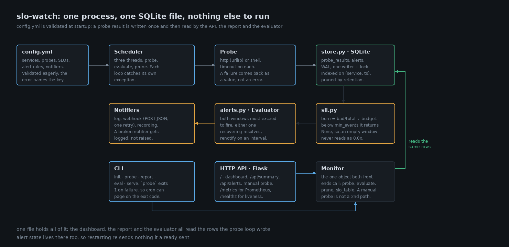
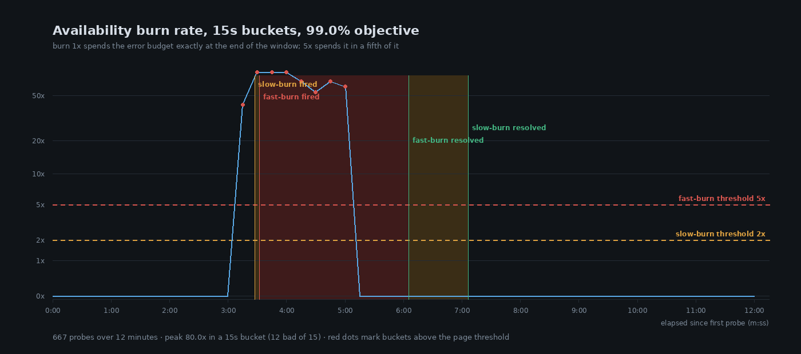

# slo-watch

Probes a service on a timer, keeps every result in SQLite, and alerts on how fast the error
budget is burning.

```
$ slo-watch -c config.yml serve --port 8080
09:00:47 ALERT FIRING checkout-api/latency fast-burn burn(long)=20.00x burn(short)=20.00x
09:03:47 ALERT FIRING checkout-api/availability fast-burn burn(long)=5.51x burn(short)=15.91x
09:06:20 ALERT RESOLVED checkout-api/availability fast-burn burn(long)=44.57x burn(short)=5.00x
```

One Flask app, one CLI, and a single file on disk. You need Python and a YAML file; there's
no agent to install and no account to create.

## Why

Error rate alerts over a fixed window are wrong at both ends. On a service taking ten
requests a minute, a 1% error rate is an outage. On one taking ten thousand a second, it's
Tuesday. So people pick a number that sort of fits their traffic, and then live with the
consequences: the alert that pages at 03:00 because the window still remembers a bad twenty
minutes, and the slow leak that never crosses a threshold long enough to fire at all.

The question I actually want answered is "at this rate, how long until the budget is gone".
That has an answer without units attached to it, which is burn rate, and there's a published
playbook for turning it into alerts. Two rules: one that pages immediately, one that files a
ticket and waits. This repo is that playbook written out, small enough to read on a slow
afternoon.

## Layout of the thing

```
config.yml ──► Scheduler ──► Probe ──────────► store.py (SQLite)
  validated      3 threads   http / shell      probe_results, alerts
  at startup     probe, evaluate, prune
                                   │
                              sli.py ──► alerts.py ──► notifiers
                              burn rate   dual window   log / webhook
                                   │
                     Monitor ──► CLI (probe, report, eval) + Flask API (/metrics, dashboard)
```



Burn rate is `(bad / valid) / (1 - objective)`. A value of 1.0 means the budget is being spent
at exactly the pace that exhausts it when the window closes, so 5x spends it in a fifth of the
window. The thresholds are multiples of that, which means the same config behaves the same way
on a service at 10 req/s and one at 10 req/min.

Each alert has a long window and a short window, and both have to be over the threshold before
it fires. Either one dropping below resolves it. In practice it's the short window that
resolves, and that's the point: recovery shows up in a minute instead of whenever the long
window drains. The long window's job is to stop a fifteen second blip from waking anyone up.

## Decisions, and what they cost

**Burn rate instead of error rate.** A raw error percentage needs a different threshold per
service and still can't tell a busy service having a bad minute from a quiet one having a bad
day. Burn rate divides by the objective so 5x means 5x everywhere, including to a reader who
has never seen this config. The cost is that nobody knows what `burn(long)=20.00x` means the
first time they see it, where "3% errors" needs no explanation. That's why the dashboard prints
compliance next to it.

**Two windows, twice the queries.** Evaluation does long and short counts for every rule, so
it's 2x the `COUNT(*)` calls it would be otherwise. At 1s evaluation with two rules that's eight
indexed queries per tick against a table at this size, which is nothing. It would not be nothing
against a few hundred million rows, and then the short window needs its own cheap aggregation.

**Missing data holds the alert state.** Under `min_events` the burn rate comes back `None` and
the evaluator does nothing at all. It doesn't fire, and it doesn't resolve. If a service is
decommissioned mid-incident, its alert stays firing until someone edits the config. I'd rather
that than have the monitor close an incident because its target stopped answering, which is the
wrong answer in the one situation where it matters.

**Failed probes aren't latency events.** The latency SLI only counts probes that succeeded. A
request that timed out never produced a latency you could judge. The cost shows up below in the
demo: during a hard outage the latency SLO reports healthy, because all it can see are the
successes.

**One SQLite file, no rollups.** Rows go in raw and get deleted by a timer. A 28 day report at
1s probing would be 2.4M rows per service, so the demo config keeps 2h and the report prints
the window it actually measured instead of pretending otherwise. The fix is hourly rollups
written from the same prune loop; it isn't here.

**Threads, not asyncio.** Three loops, each with a stop event and a `try/except` around the
body. No headroom for thousands of concurrent probes, but also no task to leak and no event
loop to accidentally block, and when something dies you get a traceback in the log.

**`min_events` is checked against the probe interval.** A short window can only ever hold
`short_window / interval` samples. Set `min_events` above that and the rule is dead: it can't
fire, ever, and nothing tells you. I found this by writing a config where a one minute window
asked for 60 samples at a one second interval, and then wondering why the rule sat there doing
nothing. The loader rejects it now and prints both numbers.

## A real run

`demo/flaky.py` slows down, then fails, then gets replaced by a healthy process. Probing every
second, 99.0% availability objective, 95.0% of requests under 250ms. `fast-burn` at 5x over
3m/1m, `slow-burn` at 2x over 6m/2m.



| phase | what the service did | probes | availability bad | latency events (bad) |
| --- | --- | --- | --- | --- |
| 0:00 to 3:20 | every request took 300-600ms | 138 | 1 | 137 (137) |
| 3:20 to 5:10 | 70% of requests returned 503 | 109 | 77 | 32 (0) |
| 5:10 to 12:10 | swapped for a process that answers in 1ms | 392 | 0 | 392 (0) |

Look at the middle row. The service is unusable for two minutes and the latency SLI sees 32
events, all of them fast, because the rest never got far enough to have a latency. The
availability SLO is the one that noticed.

```
09:00:47 WARNING alerts ALERT FIRING checkout-api/latency fast-burn burn(long)=20.00x burn(short)=20.00x
09:00:47 WARNING alerts ALERT FIRING checkout-api/latency slow-burn burn(long)=20.00x burn(short)=20.00x
09:03:42 WARNING alerts ALERT FIRING checkout-api/availability slow-burn burn(long)=2.11x burn(short)=3.57x
09:03:47 WARNING alerts ALERT FIRING checkout-api/availability fast-burn burn(long)=5.51x burn(short)=15.91x
09:05:07 WARNING alerts ALERT RESOLVED checkout-api/latency fast-burn burn(long)=14.09x burn(short)=0.00x
09:05:31 WARNING alerts ALERT RESOLVED checkout-api/latency slow-burn burn(long)=15.84x burn(short)=2.00x
09:06:20 WARNING alerts ALERT RESOLVED checkout-api/availability fast-burn burn(long)=44.57x burn(short)=5.00x
09:07:21 WARNING alerts ALERT RESOLVED checkout-api/availability slow-burn burn(long)=24.61x burn(short)=1.67x
```

Four alerts, four resolves, each one notified exactly twice. Nothing flapped.

The latency alerts go off 29 seconds in, before the service has failed a single request, because
slow is what the latency SLO is for. Availability follows two minutes later when the 503s start,
and its burn numbers look modest at first (2.11x and 5.51x), because most of that window still
holds healthy traffic. Then the latency alerts resolve at 09:05:07, in the middle of the outage, which
looks like a bug and isn't: with 70% of requests failing there are no slow requests left to
count.

The report afterwards:

```
service              slo           objective  compliance    burn  budget  exhausted in
--------------------------------------------------------------------------------------
checkout-api         availability     99.00%     88.306%  11.69x    0.0%          0.0h
checkout-api         latency          95.00%     76.740%   4.65x    0.0%          0.0h

1256 valid events · slo window 28d · raw retention 2h
```

Both budgets are gone, and should be. The run spent three of its twelve minutes broken, which
against a 99% objective that allows 1% of events works out to 11.7% bad. Zero hours left is the
honest answer.

## Running it

Python 3.10 or newer.

```bash
python3 -m venv .venv && .venv/bin/pip install -e ".[dev]"
.venv/bin/slo-watch init                 # writes a starter config.yml
.venv/bin/slo-watch -c config.yml probe  # one round of probes, exit 1 on failure
.venv/bin/slo-watch -c config.yml report # the SLI table
.venv/bin/slo-watch -c config.yml serve --port 8080
```

To see it do something, start the demo service in another shell:

```bash
python demo/flaky.py --fast --port 8099     # healthy, slow, failing, on a 20s loop
.venv/bin/slo-watch -c config.yml serve     # then open http://localhost:8080
```

Docker, which also starts the service being monitored:

```bash
docker compose up --build                   # dashboard on http://localhost:8080
```

Tests:

```
$ .venv/bin/python -m pytest -q
65 passed in 1.3s
```

They cover the maths, the window parser, config validation, probes against a real local HTTP
server including the timeout path, the SQLite store, the alert state machine, and the Flask app
through its test client.

## Endpoints

| Endpoint | Purpose |
| --- | --- |
| `GET /` | dashboard: SLOs, burn rate, budget, firing alerts, per-minute history |
| `GET /api/summary` | everything the dashboard shows, as JSON |
| `GET /api/alerts` | alert history, resolved ones included |
| `GET /api/services/<name>/recent` | the last N probe results for one service |
| `POST /api/services/<name>/probe` | probe now; the result goes into the same table |
| `GET /metrics` | Prometheus text: `slo_compliance_ratio`, `slo_burn_rate`, `slo_budget_remaining_ratio`, `slo_bad_events_total`, `slo_valid_events_total`, `slo_alerts_firing` |
| `GET /healthz` | liveness. Stays `ok` while the monitored service is down |

Webhook notifications look like this:

```json
{
  "fingerprint": "checkout-api/availability/fast-burn",
  "service": "checkout-api",
  "slo": "availability",
  "rule": "fast-burn",
  "severity": "page",
  "state": "firing",
  "burn_rate_long": 31.25,
  "burn_rate_short": 31.25,
  "started_at": 1793511602.4,
  "notifications": 1
}
```

## What it doesn't do

It isn't highly available. One process, one file; if it dies nothing is watching anything. Think
sidecar or cron job, not control plane.

There's no tracing or per-endpoint breakdown. It knows whether a URL answered and how long that
took, and that's the whole vocabulary.

Probes run from wherever the process runs, so a failure that only hits one region won't show up
from another.

Multi-step checks don't exist here: one request or one command per probe. Login flows and page
content assertions are a different product.

The latency SLO goes quiet during a hard outage, for the reason described above. Availability is
what pages in that case.

Rollups are missing, so a 28 day number from raw rows isn't honest. The report says which window
it actually measured.

And no production traffic has ever been behind this. Every number in this README comes from the
demo run, on one machine, against a service written to fail on purpose.

## Files

```
slo_watch/
  config.py     YAML to validated dataclasses; errors name the offending key
  windows.py    "5m" and "28d" to seconds and back
  probe.py      http via urllib and shell commands; failures are returned, never raised
  store.py      SQLite: probe_results plus alerts, WAL, one writer, indexed reads
  sli.py        burn rate, budget remaining, time to exhaustion
  alerts.py     the dual window state machine, notifiers, fingerprints
  monitor.py    the glue both front ends call
  scheduler.py  probe, evaluate and prune loops
  api.py        dashboard, JSON API, /metrics, /healthz
  cli.py        init, probe, report, eval, serve
tests/          65 tests, nothing leaves localhost
demo/flaky.py   a service that fails on purpose
scripts/        renders docs/*.png from a database and a transcript
docs/           the images above
```
